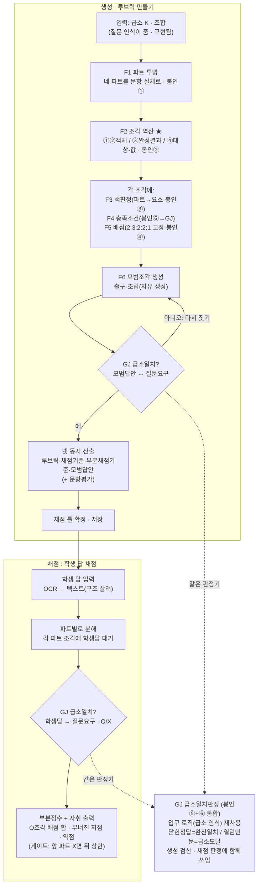

# HMOS 루브릭·채점 순서도 (클로드 코드용)

> 이 순서도 + 「HMOS_루브릭_구현명세.md」를 함께 읽고 구현한다.
> 순서도 = 부품을 잇는 흐름 / 명세 = 각 부품(F1~F6·GJ)의 입력·출력·규칙.
> 봉인 규칙(①~⑥의 알맹이)은 명세에 처리 구조까지만 있고, 실제 판정 규칙은
> 별도 봉인 모듈에서 import 한다. 코드는 흐름과 호출만 구현하고 규칙을 지어내지 않는다.

---

## 전제 — 논리스위치·표지사전 연결 (급소 인식 살리기)

> **이 순서도의 모든 흐름은 «급소 인식(입구)이 작동함」을 전제로 한다.**
> 급소 인식(v2, recognizeV2Analysis)이 돌려면 논리스위치(14개 기능표지)가
> 표지사전에 연결되어 있어야 한다. 지금은 그 연결이 안 되어 있어 급소 인식이 멈춘다.
>
> **그러므로 순서도를 구현하기 전에:**
> 1. 논리스위치(논리스위치기능표지 / 봉인 논리스위치 json)를 표지사전에 연결한다.
>    - switches 14행의 kind·color·markers·matrix가 채워져 v2가 읽게 한다.
> 2. v2를 돌려 급소·노드·간선·pivot이 나오는지 확인한다.
> 3. v2가 5색을 낱개 배열(elements)로 내는지 확인한다(문자열로 뭉치면 F2가 못 셈).
>
> 이 전제가 서야 아래 「입력: 급소 K」가 실제 값으로 들어온다.
> (상세: HMOS_봉인채우기_가이드.md)

---

## 전체 구조 — 두 흐름, 하나의 판정기(GJ)

---

## 흐름 설명 (코드 구현 순서)

### 생성 (루브릭 만들기)
1. **입력** — 질문 인식(구현됨)이 준 급소 K·조합을 받는다. 여기서 급소를 다시 잡지 않는다.
2. **F1 파트 투영** — 네 파트(근거대기·세우기·풀기·답구하기+표현)를 이 문항 실체로 매치.
3. **F2 조각 역산 ★** — 파트별로 조각 수를 센다:
   - ①개념 = 호출된 b·d 객체 수
   - ②세우기 = 호출된 c·p 구체화 객체 수
   - ③풀기 = 세워진 식에 따라 완성된 식 결과 수
   - ④답구하기 = 급소 대상·요구값의 일치 수
4. **F3·F4·F5 (각 조각에)** — 색판정(파트→요소) / 충족조건(→GJ) / 배점(고정 지수 2:3:2:2:1, 파트배점÷조각수).
5. **F6 모범조각** — 출구-조립으로 답을 자유 생성.
6. **GJ 급소일치? (검산)** — 지은 모범답안을 GJ로 검산. 아니면 F6으로 되돌아가 다시 짓기, 통과하면 진행.
7. **넷 동시 산출** — 루브릭·채점기준·부분채점기준·모범답안(+문항평가). 채점 틀 저장.

### 채점 (학생 답)
1. **학생 답 입력** — OCR로 텍스트화(구조 살려: 밑줄·수식).
2. **파트별 분해** — 각 파트의 조각에 학생 답을 댄다.
3. **GJ 급소일치? (O/X)** — 각 조각을 O/X 판정. 같은 GJ, 입력만 학생 답.
4. **부분점수 + 자취** — O 조각 배점 합. 무너진 지점(최초 X 파트), 약점(파트×요소), 게이트 상한.

---

## GJ — 두 곳에 쓰이는 하나의 판정기
- 봉인⑤(생성 검산)와 봉인⑥(채점 O/X)은 **하나의 판정기 GJ**로 통합.
- 동작: 답을 입구 로직(급소 인식, 구현됨)으로 태워 급소를 뽑고, 질문의 급소와 대본다.
- 경계(계열별): 닫힌 정답(수리)=완전 일치 / 열린 인문(논술)=급소 도달.
- 쓰임: 생성 때 모범답안 검산 / 채점 때 학생답 O/X. 대상만 다르고 동작은 같다.

---

## 게이트 (순서 상한)
- 파트는 순서이자 분류. 앞 파트가 X면 뒤 파트에 상한.
- «세워진 식에 따른» 종속으로 ③은 ②에 내장(②틀리면 ③결과도 X).
- k(급소·④)의 중심성은 배점이 아니라 게이트로 실현(못 맞추면 다른 파트 상한).
- 실제 채점표 근거: «(1) 맞아야 (2) 인정», «과정 틀리면 정답 불인정».

---

## 구현 규율
- manual mode, 한 단계씩 승인. 자문자답으로 다음 단계 스스로 실행 금지(Esc).
- `[봉인]` 규칙은 코드에 직접 쓰지 말고 봉인 모듈에서 import. 문서만으로 지어내지 않기.
- 파일 쓰기: 대상·백업·값노출 3점검. 봉인 값은 화면·로그에 개수·유무만.
- API 키(OCR 등) 환경변수. 하드코딩 금지.
- **F2(조각 역산)부터 구현·검증**: 문항 하나 넣어 조각이 나오는지 → 손산출과 대조.
